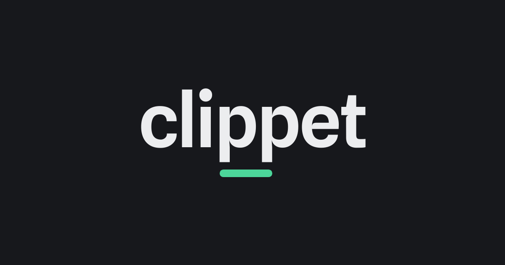

<p align="center">
  
</p>

# Clippet

**Upload a clip. Get a link.** Clippet is a self-hosted clip server. Upload a video or audio file, get a
short link, and the link plays as an embedded card in Discord and X.

## Quick start

You need Docker Engine 25 or newer, or Docker Desktop, with Compose v2. Everything else runs inside the
container.

```sh
git clone https://github.com/clippet-gg/clippet.git && cd clippet
cp .env.example .env            # every value has a working default
docker compose up -d            # one container
```

Open <http://localhost:8481/> and create an account. Registration closes after the first account, so
nobody else can sign up if the URL is public. Upload a clip and share the link. Clips are stored in
`~/Videos/clippet`; backing up that folder backs up everything.

> [!IMPORTANT]
> On Linux, Docker creates that folder owned by root, and the app runs as uid 10001. Fix the ownership
> once and restart. Docker Desktop on macOS and Windows does not need this.
>
> ```sh
> sudo chown -R 10001:10001 ~/Videos/clippet
> docker compose restart app
> ```

The first start downloads the image. Stop with `docker compose down`. Clips
and a copy of the database are in the folder; the live database is in the Docker volume
`clippet_app_data`, which only `down -v` deletes. To change the port, set
`CLIPPET_PUBLISH=127.0.0.1:PORT` in `.env`. To store clips somewhere else, set `STORAGE_DIR_HOST` before
the first start.

Configuration is read at startup, so after editing `.env` run `docker compose up -d` to apply it. To add
more users, run `clippet admin users create` ([accounts](DEPLOY.md#19-accounts-sessions-and-tokens)).

## Public URL and https

Embedded cards only work from a public https URL. X only shows a player over https, and Discord loads
the card from its own servers, so `localhost` or a LAN address shows a plain link.

To try it quickly, one `docker run` starts a temporary Cloudflare tunnel with no account, port
forwarding or certificate ([quick tunnel](DEPLOY.md#3-going-public-cloudflare-quick-tunnel)). For a
permanent setup, use a named tunnel on your own domain, or a reverse proxy like Caddy or nginx
([your own domain](DEPLOY.md#26-behind-your-own-domain-caddy-and-nginx)).

Set `PUBLIC_BASE_URL` in `.env` to the URL people will use. Card URLs are built from it, and if it is
wrong the cards silently stop working.

## Storage

By default, clips are stored in a folder on this machine. To use a NAS, mount the share and point
`STORAGE_DIR_HOST` at the mount ([using a directory](DEPLOY.md#32-a-directory-instead-of-a-bucket)).

You can also use an S3-compatible bucket: Cloudflare R2, Backblaze B2, Amazon S3, or any other S3
server. Open <http://localhost:8481/setup>, pick your provider, and it prints the `.env` block to paste;
**Check now** tests the connection. The wizard does not store your credentials
([setup wizard](DEPLOY.md#35-where-clips-live-the-setup-wizard)). With a bucket, media can also be
served straight from the bucket instead of through the app
([serving by redirect](DEPLOY.md#33-serving-media-by-redirect)).

`clippet admin storage migrate` moves an existing instance between a folder and a bucket in either direction.

## Features

**Sharing** ([quality](DEPLOY.md#27-quality-tiers-original-full-light), [links](DEPLOY.md#29-links-what-a-share-url-looks-like-and-the-two-id-grammars))

- Links play inline in Discord and X. The card shows your domain, the title and the length, with a
  green edge once the clip is ready.
- Files browsers can already play are not re-encoded. The original is served as is, with location and
  device metadata stripped. The file you uploaded, metadata included, stays in storage for your own download.
- Anything else is re-encoded once at its original resolution and frame rate. Large clips also get a
  smaller copy for the card, and viewers can pick the quality.
- Audio files work too, with a waveform as the card.
- Links are a 12-character id or three words: `your.host/aZ3kQ9xB2mLp` or
  `your.host/PurpleUpdateCharacter`.
- Share pages support oEmbed, so Slack and most forums and wikis show a preview as well.

**Uploading** ([capture tools](DEPLOY.md#9-capture-tools-sharex-replays-obs-curl), [uploading](DEPLOY.md#23-uploading))

- Upload several files at once from the browser. The title, tags and lifetime apply to all of them.
- ShareX, RePlays, OBS scripts and `curl` can upload to `/api/upload` with an API token (the ShareX
  config is one click). The response waits until the Discord card is ready, so the link works the first
  time you paste it.
- For tools that can only POST a file, create an inbound URL. The token is in the URL, and it can only upload.
- Drop a video into the media folder and it becomes a clip
  ([drop folder](DEPLOY.md#34-the-drop-folder-put-a-video-in-it-and-it-becomes-a-clip)).
  `clippet admin import` imports an existing folder of clips.
- On Android, install the site as an app and Clippet appears in the Share menu.
- Clips can expire after 1, 7, 30 or 90 days, or never
  ([lifetime](DEPLOY.md#10-clip-lifetime-ttl-keep-alive-keep-forever)).

**Discord** ([the bot](DEPLOY.md#30-the-discord-bot-upload-clip-and-enrich-in-your-own-server), [auto-post](DEPLOY.md#11-discord-auto-post))

- Post every new clip to a channel, or a channel per tag, through a webhook. A generic JSON webhook can
  notify any URL.
- An optional bot adds `/upload`, `/clip` and an **Enrich** message command to your server. Use your own
  Discord application, or connect the free official bot.
- Clippet Auto converts videos posted in a server into Clippet links, with a button or automatically.
  It is off by default and is the only feature that reads channel messages.

**Library** ([the library](DEPLOY.md#20-the-library), [tags and collections](DEPLOY.md#14-tags-and-collections))

- Tags for filtering (never shown to viewers) and collections at unguessable `/c/{id}` URLs.
- Search, a **Mine only** filter, and bulk actions.
- Trim a clip on the server with a filmstrip scrubber ([trim](DEPLOY.md#12-trim)). Generate a looping
  GIF ([GIF](DEPLOY.md#13-gif-previews)).
- Replace the video behind a link without changing the URL, title, tags or view count.
- Pick any frame as the thumbnail.
- Download and embed buttons on every clip. `/embed/{id}` takes `?autoplay`, `?muted` and `?loop`.

The UI follows your system theme and loads nothing from third parties. The "pp" in the logo is a face:
it follows the cursor, blinks when an upload lands and smiles when a clip is ready. It stays still under
reduced motion.

## Administration

- **Admin CLI.** `clippet admin` lists clips, jobs, users, sessions and tokens, retries and expires
  clips, and runs backups and restores, from inside the container. There is no admin web page
  ([operator toolbox](DEPLOY.md#24-operator-toolbox)).
- **Config check.** `clippet admin doctor` checks the config, directories, database, ffmpeg and storage,
  and reports every problem it finds. Run it after editing `.env`, before restarting.
- **Health endpoints.** `/healthz` reports the version, queue depth and 24-hour failure count; `/readyz`
  checks storage live. Neither exposes clip or user data.
- **Stuck jobs.** Jobs interrupted by a crash are retried or marked failed automatically. `admin jobs
  unstick` does it on demand.
- **Backups.** `admin backup <dir> --rotate 7` writes a dated database snapshot and keeps seven. A copy of
  the database is also kept in the storage folder or bucket, so the storage alone is enough to restore
  ([backup and restore](DEPLOY.md#15-backup-and-restore)).
- **Registration.** `REGISTRATION` is `first`, `open`, `closed`, `members` or `role:<id>`. The last two let
  people sign in through the Discord bot.
- **API tokens** are scoped: `upload` for capture tools, `read` for backup scripts. Neither can change
  account settings.
- **Storage costs.** Enter your provider's prices and Settings estimates the monthly bill. Set a budget
  for a warning, or `STORAGE_BUDGET_HARD=1` to make it a hard limit
  ([costs](DEPLOY.md#31-what-this-instance-costs)).
- **Performance.** Encoding uses the container's CPU quota; set `APP_CPUS=4` or more on a real server. An
  optional GPU image uses NVIDIA hardware encoding.

## Not included

- **No telemetry, analytics or update checks.** Unless you enable Discord features or webhooks, the only
  outbound connection is to your bucket, and CI fails if a new one is added.
- **No watermarks or ads.** Nothing is added to your video. The smaller copy made for the card carries a
  one-line quality label by default, and `LIGHT_TAG_TEXT=off` removes it. Watch pages have no sign-up
  prompts or related-clips feed.
- **No tiers or per-user quotas.** The only limits are the upload size cap, a rate limit, and the optional
  storage budget.
- **No social features.** No likes, comments, followers, feeds or public browse page. View counts are
  visible only to the clip's owner.
- **No per-clip passwords.** A password page would break the Discord card. Use unlisted clips and short
  lifetimes for anything sensitive; the unguessable id is the protection.
- **No upload from a URL.** It would add an outbound connection that could reach into your LAN. Download
  on your machine and upload the file instead.
- **No multi-tenancy, federation or email.** One instance serves one group of people. There is no
  password reset, since there is no email.

## Upgrading

Back up, check out the new tag, then run `docker compose pull && docker compose up -d`. To pin a
release, set `CLIPPET_VERSION=2026.11.07` in `.env`.
Migrations run at startup and `/healthz` shows the new version ([upgrading](DEPLOY.md#16-upgrading)).
Releases are tagged by date (`vYYYY.MM.DD`) and listed in [`CHANGELOG.md`](CHANGELOG.md).

## Desktop app and Clippet Pass

**Clippet for Windows and macOS** runs this server as a tray app, with storage, the Discord connection
and updates handled in a window. Download it at [get.clippet.gg](https://get.clippet.gg).

**Clippet Pass** is an optional paid service from the maintainer that gives your instance a
`yourname.clippet.gg` address with https and no port forwarding. The self-hosted server is complete
without it and does not change when you have one
([details](DEPLOY.md#361-what-the-product-does-for-a-pass-nothing)).

## Architecture

A single Go binary runs the HTTP server, the transcode worker and the expiry sweeper. State is in
SQLite, media is in the folder or bucket, and a static ffmpeg build is included in the image. The
compose stack is one service. The frontend is plain HTML, CSS and JavaScript with no build step.
To build the image from source instead of pulling it, run
`docker compose -f compose.yaml -f compose.build.yaml up -d --build`.
Clippet was written from scratch from a written spec, without reference to any other clip server's code.

Development happens in containers, so no local Go or Node is needed. See
[`CONTRIBUTING.md`](CONTRIBUTING.md) for running the tests and submitting changes.

## Documentation

- [`DEPLOY.md`](DEPLOY.md): the operator guide. Configuration, https, day-to-day operation, backups, upgrades.
- [`API.md`](API.md): every route with its auth and wire format, for capture tools and scripts.
- [`DESIGN.md`](DESIGN.md): architecture and design decisions.
- [`web/STYLE.md`](web/STYLE.md) and [`docs/brand/`](docs/brand/README.md): the visual system and the logo.
- [`SECURITY.md`](SECURITY.md): reporting vulnerabilities, and what operators should know.
- [`THIRD_PARTY.md`](THIRD_PARTY.md): licenses of bundled software.

Bugs and feature requests: Issues. Questions about running an instance: Discussions.

## License

Functional Source License 1.1 with Apache 2.0 as the future license ([`LICENSE`](LICENSE)). You can
use, modify and self-host it freely; the one restriction is offering it as a competing hosted service.
Each release becomes Apache 2.0 two years after it ships. The Clippet name and logos are trademarks and
are not covered by the license ([`docs/brand/`](docs/brand/README.md)).
